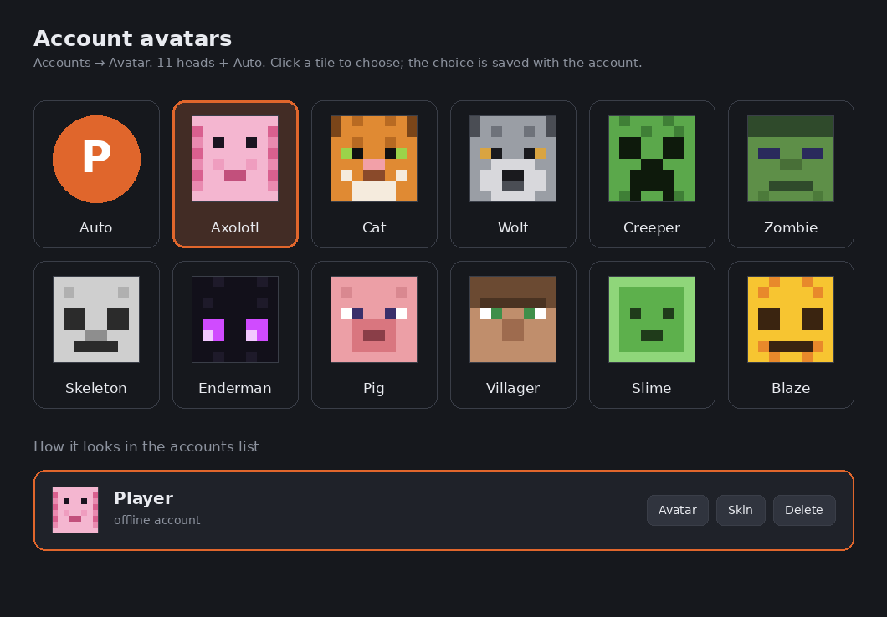

# Ferrum Launcher

A Minecraft launcher written in Rust. A single executable, no Electron and no installer.

- **Instances**: any name, a separate folder, own memory and JVM arguments
- **Loaders**: Vanilla, Fabric, Quilt, Forge, NeoForge
- **Modpack export** to `.mrpack` and **skins** for offline accounts
- **Modpack import**: Modrinth (`.mrpack`) and CurseForge (`.zip`), just drag the file into the window
- **Mods**: search and install from CurseForge or Modrinth, enable or disable with one click
- **Accounts**: offline and temporary (created in the launcher, valid for 24 hours), with a choice of avatar: 11 character heads or the face of your skin
- **Java**: the required version is picked or downloaded automatically
- **Optimization**: Sodium (Fabric, Quilt, NeoForge) and OptiFine (Forge) are installed automatically
- **Logs**: a log for every launch and a separate folder for every game crash
- **Play time** per instance and a launch counter
- **Custom images**: any background and your own icon (drag the file into the window)
- **Appearance**: your own interface color (any color from a palette), 9 ready-made accents, 10 background palettes (including light ones), corner style, scale 90–150%

## Building from source

You need [Rust](https://rustup.rs) (stable).

```bash
git clone https://github.com/ArturOriginos/ferrum-launcher
cd ferrum-launcher
cargo run --release
```

Run the logic tests with `cargo test`.

On Linux you may need these packages: `libxkbcommon-dev libwayland-dev libx11-dev libgl1-mesa-dev`.

## CurseForge

CurseForge serves mods only with an API key. Get a free key at
<https://console.curseforge.com> and paste it into **Settings → Mods**.
Every user enters their own key: embedding a key into public builds is forbidden by the CurseForge rules.
Modrinth works without a key.

## Exporting modpacks

Select an instance on the **Instances** page and press **Export**. The `.mrpack` file appears in the `exports` folder inside the launcher's data folder. Mods are looked up on Modrinth by checksum and are added to the file as links. Mods that are not there can be put inside the archive (check their license). Worlds, logs and screenshots are not exported.

## Skins

In **Accounts → Skin** choose a 64×64 or 64×32 PNG (up to 200 KB) or drag the file into the window. In the game the skin is shown by the [CustomSkinLoader](https://modrinth.com/mod/customskinloader) mod, which the launcher installs by itself for instances with Fabric, Quilt, Forge and NeoForge. The skin is visible only in your own game, other players will not see it.

## Avatars

In **Accounts → Avatar** pick a head for the account: Axolotl, Cat, Wolf, Creeper, Zombie, Skeleton, Enderman, Pig, Villager, Slime or Blaze. **Auto** shows the face of the account's skin, or the first letter of the nickname if there is no skin. The avatar is shown in the launcher only (side panel and accounts list) and does not change how you look in the game, that is what skins are for.



The pictures are simplified 8×8 pixel art drawn by the launcher itself (`src/avatar.rs`), not files taken from the game.

## Importing modpacks

On the **Instances** page press **Import** or drag a file into the launcher window. Supported formats:

- `.mrpack` (Modrinth), no key needed;
- `.zip` (CurseForge), your API key is required in **Settings → Mods**.

The launcher shows the name, game version and loader, then downloads the mods and copies the settings. Files that could not be fetched are listed in a report. On CurseForge a mod author can forbid distribution through the API: such mods have to be downloaded manually into the `mods` folder.

## Custom images

In **Settings → Custom images** you can set your own background and icon. You can drag the file right into the launcher window.

| | Icon | Background |
|---|---|---|
| Format | PNG, JPG, WebP | PNG, JPG, WebP |
| File size | up to 5 MB | up to 10 MB |
| Resolution | from 128×128 to 2048×2048 | from 800×450 to 7680×4320 |
| Aspect ratio | strictly square 1:1 | any, 16:9 works best |

The icon of the `.exe` itself is set at build time (`assets/icon.ico`) and does not change while the launcher is running.

## Logs

- `logs/launches` — a log of every launch (command, Java version, game output)
- `logs/crashes/<date>_<instance>` — on a crash: the launch log, `latest.log`, `crash-reports`, `hs_err`

You can open the folder in **Settings → Data** or in the error window.

## Version compatibility

The launcher reads the configs and instances of all earlier versions. If the format of `config.json` does not fit, a copy `config.backup-<date>.json` is created next to it and everything that can be read is taken from it. Unknown fields from configs of other versions are preserved on save (since version 0.6.1). The format number is stored in the `config_version` field.

## Antivirus

New programs without a digital signature often raise suspicion in antivirus software; these are false positives. What has been done and what you can do:

- The author's name, description, copyright and icon are embedded into the `.exe`.
- Every release comes with a `.sha256` file. To verify: `certutil -hashfile ferrum-launcher-...zip SHA256` (Windows) or `shasum -a 256 -c file.sha256`.
- The files are built on GitHub Actions from open source code. The origin is confirmed with `gh attestation verify <file> --owner ArturOriginos`.
- If your antivirus complains, submit the file as a false positive: [Microsoft Defender](https://www.microsoft.com/wdsi/filesubmission), as well as the form of your antivirus. Uploading to [VirusTotal](https://www.virustotal.com) shows how many engines disagree.
- Only code signing (a paid certificate) removes the problem completely. For open source projects there are free options, for example SignPath Foundation.

## Notes

- OptiFine has no API. The launcher takes the link from the optifine.net page, and if the site changes, the automatic installation will not work. In that case download OptiFine manually into the mods folder.
- Sodium for NeoForge exists only for new game versions (1.21+).

- Offline accounts are not allowed on servers with license verification.
- The data lives in a folder whose path is shown in **Settings → Data**.
- Minecraft is a trademark of Mojang AB. This project is not affiliated with Mojang or Microsoft.

License: MIT.
